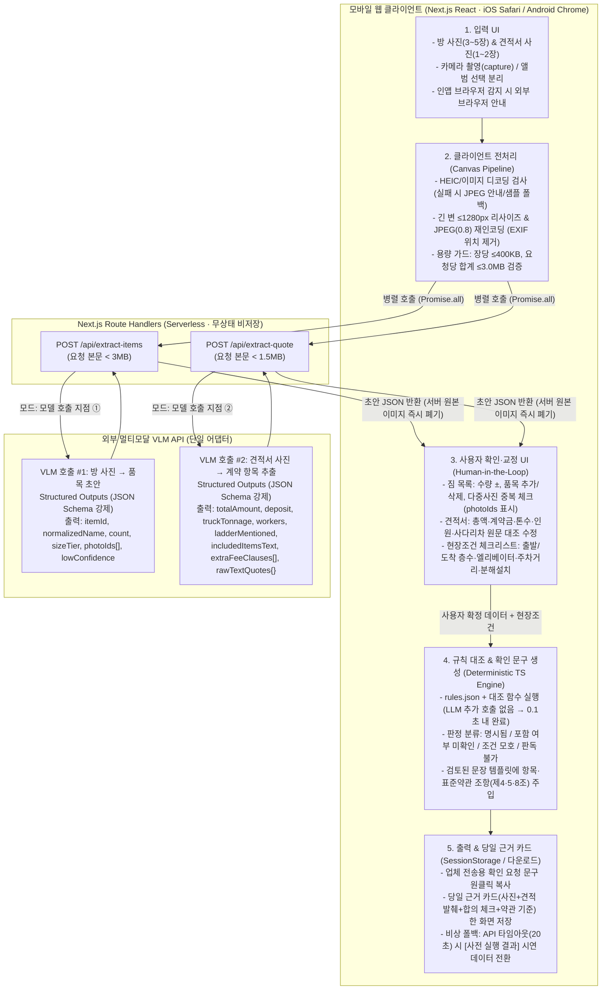

# B005 지휘부 검증 (Argon · 기술·구현 관점) — 블라인드 독립 리뷰

검토 대상: [B005-이사-지킴이.md](file:///mnt/c/Users/User/Desktop/대학교/3학년/AI Platform Build Challenge/briefs/B005-이사-지킴이.md), [b005-evidence.sol.md](file:///mnt/c/Users/User/Desktop/대학교/3학년/AI Platform Build Challenge/runs/out/b005-evidence.sol.md), [b005-benchmark.sonnet.md](file:///mnt/c/Users/User/Desktop/대학교/3학년/AI Platform Build Challenge/runs/out/b005-benchmark.sonnet.md), [b005-plan.sol.md](file:///mnt/c/Users/User/Desktop/대학교/3학년/AI Platform Build Challenge/runs/out/b005-plan.sol.md), [b005-plan.sonnet.md](file:///mnt/c/Users/User/Desktop/대학교/3학년/AI Platform Build Challenge/runs/out/b005-plan.sonnet.md), [b005-peer-on-sol.sonnet.md](file:///mnt/c/Users/User/Desktop/대학교/3학년/AI Platform Build Challenge/runs/out/b005-peer-on-sol.sonnet.md), [b005-peer-on-sonnet.sol.md](file:///mnt/c/Users/User/Desktop/대학교/3학년/AI Platform Build Challenge/runs/out/b005-peer-on-sonnet.sol.md)

---

## 1 & 2. 핵심 주장 판정 대상 목록 (T1~T10) 및 항목별 판정

두 제작 계획([b005-plan.sol.md](file:///mnt/c/Users/User/Desktop/대학교/3학년/AI Platform Build Challenge/runs/out/b005-plan.sol.md), [b005-plan.sonnet.md](file:///mnt/c/Users/User/Desktop/대학교/3학년/AI Platform Build Challenge/runs/out/b005-plan.sonnet.md))의 핵심 주장을 10개 기술 쟁점(T1~T10)으로 묶고, 상호 검증([b005-peer-on-sol.sonnet.md](file:///mnt/c/Users/User/Desktop/대학교/3학년/AI Platform Build Challenge/runs/out/b005-peer-on-sol.sonnet.md), [b005-peer-on-sonnet.sol.md](file:///mnt/c/Users/User/Desktop/대학교/3학년/AI Platform Build Challenge/runs/out/b005-peer-on-sonnet.sol.md))의 지적 사항 수용 여부를 함께 판정한다.

### **T1. 웹 vs 앱 결론 — 설치 없는 반응형 모바일 웹 채택 (PWA 설치·네이티브 앱 배제)**
- **두 계획의 주장**: Sol과 Sonnet 모두 앱 설치 장벽 제거, URL/문구 공유, 9시간 내 배포, 심사위원 QR 시연을 이유로 **설치 없이 브라우저 탭에서 바로 쓰는 반응형 모바일 웹**을 선택했다.
- **판정**: **찬성**
- **이유**: 추정: 9시간 해커톤에서 네이티브나 React Native/Flutter 빌드·서명·배포를 검증하는 것은 실패 확률이 높고, 웹 개발 강점 팀 조건에도 모바일 웹이 부합한다. HTML `<input type="file" accept="image/*" capture="environment">`는 MDN 문서상 "Limited availability"이며 OS·브라우저마다 동작이 다를 수 있으므로(https://developer.mozilla.org/en-US/docs/Web/HTML/Reference/Attributes/capture), 카메라 직접 호출(`capture`) 버튼과 일반 앨범 파일 선택 버튼을 분리 제공하는 구조가 가장 안전하다. 또한 iOS 홈 화면 웹앱(PWA)에서는 미디어 캡처 재진입 관련 이슈가 보고된 바 있어(https://bugs.webkit.org/show_bug.cgi?id=185448, https://developer.apple.com/forums/thread/797987), PWA 설치를 유도하지 않고 일반 Safari/Chrome 탭에서 동작시키는 결정이 타당하다.
- **상호 검증 수정안 수용 여부**: **수용한다.**
  - [b005-peer-on-sol.sonnet.md](file:///mnt/c/Users/User/Desktop/대학교/3학년/AI Platform Build Challenge/runs/out/b005-peer-on-sol.sonnet.md)(V4, V5) 지적대로 iOS `<input capture>` 실제 동작은 실기기 검증 전 가설로 표기하고, 카카오톡 등 인앱 브라우저 동작은 `unknown`이므로 인앱 접속 시 외부 브라우저(Safari/Chrome) 열기 안내 배너를 넣는다.
  - [b005-peer-on-sonnet.sol.md](file:///mnt/c/Users/User/Desktop/대학교/3학년/AI Platform Build Challenge/runs/out/b005-peer-on-sonnet.sol.md)(W3, W4, W5) 지적대로 `MediaRecorder`(https://webkit.org/blog/11353/mediarecorder-api/, https://caniuse.com/mediarecorder) 및 iOS 10분 녹화 제한 포럼 보고(https://developer.apple.com/forums/thread/655193)를 현행 iOS 전체의 파일 업로드 제한처럼 일반화하지 않는다.

---

### **T2. 기술 스택 — Next.js(React+TS) 단일 코드베이스 + 단일 멀티모달 VLM 어댑터 + 무상태(Stateless) 처리**
- **두 계획의 주장**: Next.js(React + TypeScript)로 프런트엔드와 서버 API(Route Handler)를 단일 저장소로 묶고, 서버에서 멀티모달 LLM API(OpenAI `gpt-5.4-mini` 또는 Claude Vision / Gemini)를 호출해 Structured Outputs(고정 JSON 스키마)를 받으며, P0에서는 DB/객체 스토리지 영구 저장 없이 세션(단말 스토리지) 중심으로 처리한다.
- **판정**: **찬성**
- **이유**: 추정: 프런트와 백엔드 API 라우트를 Next.js 단일 프로젝트로 구성하면 CORS·인증·타입 공유 비용이 사라져 9시간 구현에 가장 유리하다. OpenAI(`gpt-5.4-mini`, https://developers.openai.com/api/docs/models/gpt-5.4-mini)와 Anthropic Claude Vision(https://platform.claude.com/docs/en/build-with-claude/vision) 모두 이미지 입력과 JSON 스키마 강제를 지원하므로 얇은 어댑터 함수 1개로 추상화해 준비 기간 실측 후 모델을 확정하면 된다. 원본 사진을 서버에 영구 저장하지 않는 무상태 구조는 집 내부 사진·견적서의 개인정보 위험과 백엔드 DB 구축 시간을 동시에 줄인다.
- **상호 검증 수정안 수용 여부**: **수용한다.**
  - [b005-peer-on-sol.sonnet.md](file:///mnt/c/Users/User/Desktop/대학교/3학년/AI Platform Build Challenge/runs/out/b005-peer-on-sol.sonnet.md)(A5, A7) 및 [b005-peer-on-sonnet.sol.md](file:///mnt/c/Users/User/Desktop/대학교/3학년/AI Platform Build Challenge/runs/out/b005-peer-on-sonnet.sol.md)(T1) 지적을 모두 반영한다. 모델별 이미지/PDF 한도를 플랫폼 문서 기준(https://platform.claude.com/docs/en/build-with-claude/vision, https://platform.claude.com/docs/en/build-with-claude/pdf-support)으로 정확히 적고, "우리 서버 미저장"이 "외부 API 무보관"을 뜻하지 않음을 명시한다(OpenAI API 남용 모니터링 로그 최대 30일 보관 정책: https://developers.openai.com/api/docs/guides/your-data).

---

### **T3. P0 기능 범위 — 계약 전 대조·확인 문구 생성 집중 및 과잉 기능(PDF·영상·마스킹 UI·공유 DB·임대차 흠집) 제외**
- **두 계획의 주장**: 방 사진→짐 목록 초안, 견적서 사진→항목 추출, 현장조건 입력·대조 결과, 업체 확인 문구 생성·복사를 P0로 둔다. 단, Sol은 '업체 답변 첨부 및 당일 근거 카드'까지 P0(6개 기능)로 넣었고 이미지 마스킹 UI를 본문에 언급했으며, Sonnet은 'PDF 입력'을 P0-2에 넣되 '당일 근거 카드'는 P1-1로 두었다. 임대차 보증금 흠집 기록은 두 계획 모두 본선 구현에서 제외(P2)했다.
- **판정**: **보류 (범위 축소 조건부 찬성 — PDF·이미지 마스킹 UI·업체 답변 첨부는 P0에서 제외, 당일 근거 카드는 정적 요약 뷰로 단순화)**
- **이유**: 추정: 9시간 안에 수정 UI가 달린 P0 6개 기능과 이미지 마스킹 에디터, PDF 파싱 분기를 모두 완주하는 것은 불가능하며, 시연 안정성을 해친다. P0는 **① 방 사진(JPEG/PNG 3~5장)→짐 목록 확인 ② 견적서 사진(JPEG/PNG 1~2장)→항목 확인 ③ 현장조건 체크+규칙 대조 카드 ④ 확인 문구 복사 + 한 화면 요약(당일 근거 카드 겸용)**의 4단계 단일 파이프라인으로 고정해야 한다. 임대차 퇴거 흠집 기록은 계약 상대방(임대인)과 법적 근거가 전혀 달라 주제를 흐리므로 P2로 미루는 판단에 전적으로 동의한다.
- **상호 검증 수정안 수용 여부**: **수용한다.**
  - [b005-peer-on-sol.sonnet.md](file:///mnt/c/Users/User/Desktop/대학교/3학년/AI Platform Build Challenge/runs/out/b005-peer-on-sol.sonnet.md)(§11 상세 3, 6)가 지적한 '클라이언트 마스킹 UI(반나절 소요)'와 '업체 답변 첨부·재점검'은 P0에서 빼고 업로드 전 주의 안내 문구로 대체한다.
  - [b005-peer-on-sonnet.sol.md](file:///mnt/c/Users/User/Desktop/대학교/3학년/AI Platform Build Challenge/runs/out/b005-peer-on-sonnet.sol.md)(I2, 전체 수정 의견)가 지적한 'PDF 입력 처리' 역시 Canvas 전처리 파이프라인과 분기되므로 P0에서 제외하고 이미지(사진/스크린샷)만 받는다.

---

### **T4. 사진→짐 목록 추출 — 부피·톤수 자동 산정 포기 + 다중 사진 중복 제어 + 사용자 확인 필수 UX**
- **두 계획의 주장**: VLM은 방 사진에서 대형 가구·가전 품목 후보와 수량만 추출하고, 사진만으로 부피(㎥)·무게·차량 톤수를 자동 산정하지 않는다. VLM의 개수 세기 한계 때문에 **사용자 수량·품목 확인 및 수정 화면**을 필수 단계로 둔다.
- **판정**: **찬성**
- **이유**: 한국 내 '품목별 부피 → 차량 톤수 → 요금'의 공식 환산 기준은 확인되지 않았으며(`unknown`), VLM 역시 물체 개수 세기와 정밀 위치 파악에 한계가 있음이 공식 문서(https://developers.openai.com/api/docs/guides/images-vision, https://platform.claude.com/docs/en/build-with-claude/vision)와 학술 연구(*Visual Enumeration Remains Challenging for Multimodal Generative AI*, arXiv:2402.03328, https://arxiv.org/abs/2402.03328; *Your Vision-Language Model Can't Even Count to 20*, arXiv:2510.04401, https://arxiv.org/abs/2510.04401; TallyQA, arXiv:1810.12440, https://arxiv.org/abs/1810.12440)에서 반복 확인된다. 또한 Yembo(https://yembo.ai/moving/surveys), Agoyu(https://agoyu.com/faqs/), 내집이사(https://www.startupn.kr/news/articleView.html?idxno=30481), 노블로지스(https://m.news.nate.com/view/20260909n33830)가 이미 사진 기반 인벤토리·견적 생성을 표방하므로, 인벤토리 생성은 입력 보조로 낮추고 사용자가 확정한 목록을 견적서와 대조하는 설계가 기술적·전략적으로 옳다.
- **상호 검증 수정안 수용 여부**: **수용한다.**
  - [b005-peer-on-sonnet.sol.md](file:///mnt/c/Users/User/Desktop/대학교/3학년/AI Platform Build Challenge/runs/out/b005-peer-on-sonnet.sol.md)(I3) 지적처럼 방 사진 여러 장에 같은 침대·책장이 찍힐 때 단순 합산하면 수량이 부풀려진다. Sol의 계획([b005-plan.sol.md](file:///mnt/c/Users/User/Desktop/대학교/3학년/AI Platform Build Challenge/runs/out/b005-plan.sol.md) §3, §6)처럼 각 품목에 **출처 사진 번호(`photoIds`)**를 함께 출력하고, 다중 사진 간 동일 물품 의심 시 사용자 확인 UI에서 체크하도록 결합한다. Grounding DINO(arXiv:2303.05499, https://arxiv.org/abs/2303.05499)는 별도 배포 부담이 크므로 당일 파이프라인에서는 제외한다.

---

### **T5. 견적서 OCR→JSON 추출 — 동일 VLM 기본 추출 + 원문 발췌 연결 + 수동 교정 폴백**
- **두 계획의 주장**: 견적서·계약서 사진을 VLM에 입력해 총액, 계약금, 차량 톤수·대수, 인원, 장비(사다리차 등), 포함 품목·특약 문구와 **원문 발췌 문장(`rawTextQuote`)**을 고정 JSON 스키마로 추출하고, 금액 불일치나 미판독 필드는 사용자 확인 화면에서 교정한다. 별도 전용 OCR(CLOVA General OCR, Upstage Document OCR)은 비교·보조 후보로 둔다.
- **판정**: **찬성 (단, 본선 9시간 내에는 단일 VLM으로 통일하고 전용 OCR 연동은 준비 기간 실험에서 VLM이 실패할 때만 채택)**
- **이유**: 한국어 이사 견적서에 대한 공개 OCR 벤치마크는 `unknown`이며(일반 다국어·손글씨 한계는 OCRBench arXiv:2305.07895 참조, https://arxiv.org/abs/2305.07895), 수기·저화질 견적서에서는 오독 위험이 상존한다. 추정: 9시간 해커톤 당일에 CLOVA General OCR(https://api.ncloud-docs.com/docs/ai-application-service-ocr-ocr)이나 Upstage Document OCR(https://console.upstage.ai/docs/capabilities/document-ocr) 파이프라인과 LLM 구조화를 이중으로 연결하면 장애 지점이 2배가 된다. 당일에는 단일 VLM의 Structured Outputs로 필드와 원문 인용구를 동시에 뽑고, 핵심 숫자(총액·계약금·톤수·인원)를 사용자가 원문 이미지와 나란히 보고 고칠 수 있는 UI로 푸는 것이 가장 견고하다.
- **상호 검증 수정안 수용 여부**: **수용한다.**
  - [b005-peer-on-sol.sonnet.md](file:///mnt/c/Users/User/Desktop/대학교/3학년/AI Platform Build Challenge/runs/out/b005-peer-on-sol.sonnet.md)(§11 상세 5)가 긍정 평가한 Sol의 축소 기준("12시에 견적 추출이 불안정하면 자동 읽기를 보조로 낮추고 사용자 입력 경로 완성")을 공식 폴백 규칙으로 채택한다.

---

### **T6. AI와 규칙 엔진의 역할 분담 — 법령·약관 판정 및 확인 문구 생성의 결정론적(Deterministic) 통제**
- **두 계획의 주장**: AI가 법적 위법 여부를 단정하거나 약관 조항을 직접 생성하지 못하게 막고, 표준약관(제4조, 제5조, 제8조 등)·화물자동차 운수사업법 시행규칙(제38조의3)·소비자분쟁해결기준은 정적 규칙(`rules.json` + 코드)으로만 매핑한다.
  - 차이점: 대조 및 확인 문구 생성에서 Sol은 **규칙 비교 + 검토된 고정 문장 틀(템플릿) 삽입**을 기본으로 한 반면, Sonnet은 **LLM 의미 대조 + LLM 확인 문구 초안 생성(4번째·5번째 LLM 호출)**을 넣었다.
- **판정**: **보류 (Sol의 '규칙 대조 + 고정 문장 템플릿' 방식 채택, Sonnet의 '문구 생성용 추가 LLM 호출' 및 '불완전한 취소·소멸시효 규칙'은 반대)**
- **이유**: 추정: 확인 문구 생성에 LLM을 다시 호출하면 응답 시간이 5~15초 늘어나고 할루시네이션(없는 조항·단정적 법률 표현 생성) 위험만 커진다. 품목 정규화·동의어 매핑("책꽂이↔책장", "포괄 문구 여부")까지만 앞단 LLM 추출/정규화에서 처리하고, **미확인 카드 판정과 확인 문구 생성은 100% 결정론적(Deterministic) 코드 규칙과 고정 템플릿**으로 처리해야 빠르고 안전하다. 또한 견적에 "가구 일체"라고 적힌 경우 '누락'이 아니라 **'명시 여부 미확인 / 조건 모호'**로 분류하는 Sol의 설계가 분쟁 예방 목적에 부합한다.
- **상호 검증 수정안 수용 여부**: **전면 수용한다.**
  - [b005-peer-on-sonnet.sol.md](file:///mnt/c/Users/User/Desktop/대학교/3학년/AI Platform Build Challenge/runs/out/b005-peer-on-sonnet.sol.md)(L1~L11, I4, 전체 수정 의견)가 지적한 법률 규칙 결함을 반영해, ① 단일 문서 입력으로 실행 불가능한 R2(견적서 vs 계약서 두 문서 금액 비교)는 '체크리스트 안내'로 바꾸거나 두 금액 입력 시에만 동작하게 하고(제5조 제3항의 '고객 요청 변경 + 사전 고지' 두 예외 요건 명시: https://www.mowda.kr/terms, https://www.easylaw.go.kr/CSP/CnpClsMain.laf?ccfNo=3&cciNo=2&cnpClsNo=1&csmSeq=666), ② 예외 조건 누락 시 오안내 위험이 높은 취소 배상 자동 계산(제9조 계약금 반환 별도 조건 누락), 소멸시효(제18조 5년 예외 누락), 서류 미발급 무조건 경고(시행규칙 제38조의3 제2항 제5·6호의 화주 거절·무과실 예외 누락: https://law.go.kr/LSW/lsLinkCommonInfo.do?lspttninfSeq=188629)는 P0 자동 판정 규칙에서 제외하고 원문 조건을 포함한 참고 링크로만 제공한다.
  - 공정위 표준약관 제10035호 원본 PDF 대조는 두 계획 모두 아직 완료하지 못했으므로(목록: https://www.ftc.go.kr/www/selectBbsNttList.do?bordCd=201&key=202&pageIndex=6&pageUnit=10&searchCnd=all), 제출 전 원본 대조를 필수 과제로 못 박는다.

---

### **T7. 시연 실패 지점 방어 — 클라이언트 이미지 리사이즈·HEIC 방어·Vercel 4.5MB 제한·응답 지연 제어**
- **두 계획의 주장**: Sonnet은 클라이언트 `<canvas>`로 긴 변 ≤1568px JPEG 리사이즈(품질 ≥0.85) 및 EXIF 제거를 제안했고, Sol은 메타데이터 제거와 촬영/업로드 분리를 제안했다.
- **판정**: **찬성 (단, 상호 검증에서 드러난 Vercel 4.5MB 한도·HEIC 디코딩 예외·다중 호출 지연 방어 설계를 필수로 결합)**
- **이유**: 해커톤 현장 시연이 가장 많이 깨지는 지점이 바로 **스마트폰 고화질 사진 업로드**다.
  1. **용량 제한(413 Payload Too Large)**: Vercel Serverless Function의 요청 본문 제한은 **4.5MB**다(https://vercel.com/docs/functions/limitations). 스마트폰 원본 사진(장당 3~8MB) 4~5장을 그대로 `POST /api/analyze`에 보내면 즉시 413 에러로 시연이 중단된다.
  2. **HEIC 포맷 호환성**: iPhone 카메라·앨범 사진은 HEIC 포맷일 수 있는데, Claude Vision API 등은 JPEG/PNG/GIF/WebP만 지원한다(https://platform.claude.com/docs/en/build-with-claude/vision). Safari 17 이상은 HEIC 표시를 지원하지만(https://developer.apple.com/documentation/safari-release-notes/safari-17-release-notes), 타 브라우저나 구형 환경에서 `<canvas>` 디코딩이 실패할 수 있다.
  3. **모델 응답 시간**: 방 사진 여러 장과 견적서 사진을 순차로 LLM에 보내면 30~60초 이상 걸려 3분 시연이 멈춘다.
- **상호 검증 수정안 수용 여부**: **전면 수용한다.**
  - [b005-peer-on-sol.sonnet.md](file:///mnt/c/Users/User/Desktop/대학교/3학년/AI Platform Build Challenge/runs/out/b005-peer-on-sol.sonnet.md)(§11 상세 1, 2) 및 [b005-peer-on-sonnet.sol.md](file:///mnt/c/Users/User/Desktop/대학교/3학년/AI Platform Build Challenge/runs/out/b005-peer-on-sonnet.sol.md)(W6, I1)의 지적을 결합해 다음 4중 방어선을 아키텍처에 강제한다:
    ① 클라이언트에서 Canvas로 긴 변 1280~1568px, JPEG quality 0.8로 압축해 **장당 400KB 이하, 요청당 총합 3.0MB 이하**를 강제 검사한다.
    ② `createImageBitmap` / `Image.decode()` 실패(HEIC 미지원 브라우저 등) 시 즉시 감지하여 "아이폰 카메라 설정 > 포맷 > 높은 호환성(JPEG) 또는 스크린샷 이미지를 선택해 주세요" 안내와 샘플 이미지 선택 버튼을 띄운다.
    ③ 방 사진 분석(`/api/extract-items`)과 견적서 분석(`/api/extract-quote`)을 **별도 엔드포인트로 분리·병렬 호출(`Promise.all`)**하여 개별 요청 용량(4.5MB 미만)과 전체 대기 시간(추정: 15~25초 이내)을 동시에 줄인다.

---

### **T8. 9시간 당일 일정 및 인원별(1~3인) 역할 분담 현실성**
- **두 계획의 주장**: 09:00~18:00 9시간 동안 09~10시 환경/업로드, 10~12시 사진·견적 추출, 12~14시 대조·문구, 14~15시 통합 완주, 15~18시 검증·평가·시연 리허설을 배치했다.
- **판정**: **보류 (시간표 재조정 조건부 찬성 — 이미지 압축을 09~10시 1순위로 배치하고, 1인 참가 시 P0 범위 대폭 축소)**
- **이유**: [b005-peer-on-sol.sonnet.md](file:///mnt/c/Users/User/Desktop/대학교/3학년/AI Platform Build Challenge/runs/out/b005-peer-on-sol.sonnet.md)(T1)와 [b005-peer-on-sonnet.sol.md](file:///mnt/c/Users/User/Desktop/대학교/3학년/AI Platform Build Challenge/runs/out/b005-peer-on-sonnet.sol.md)(I5)가 공통으로 지적했듯, 두 계획 모두 당일 9시간 안에 처음부터 구현하기에는 UI 교정 화면과 예외 처리 작업량이 과소평가되어 있다. 추정: 특히 1인 참가자가 프런트, 백엔드, 프롬프트, 규칙 엔진, 실기기 테스트, 발표까지 15시 전에 끝내려면 기능을 절반으로 줄이거나 단일 통합 화면으로 가야 한다. 또한 16~17시에 18~20건의 최종 평가셋을 수동 채점할 시간이 없으므로, 채점 스크립트는 반드시 사전 준비하거나 당일에는 스모크 테스트(3~5건)만 돌려야 한다.
- **상호 검증 수정안 수용 여부**: **수용한다.** 아래 제4절의 '권장 9시간 시간표'에서 클라이언트 이미지 리사이즈/용량 제한을 09~10시 필수 과제로 명시하고, 12시·15시 강제 축소(Cut-off) 게이트와 1인/2인/3인별 현실적 범위를 확정한다.

---

### **T9. 사전 준비물 (11/27 전에 미리 해도 되는 것과 안 되는 것)**
- **두 계획의 주장**: 본선 해커톤의 사전 코딩 허용 여부가 공식 안내에서 확인되지 않았으므로(`unknown`), 당일 0부터 구현 가능한 범위를 기준으로 삼되 11/2~11/25 준비 기간에는 평가셋 제작, 약관 원문 검증, API 프롬프트 실험, 실기기 브라우저 호환성 확인을 진행한다.
- **판정**: **찬성 (단, 사전 준비물을 '규정 무관 100% 허용 비코드 자산'과 '사전 코딩 허용 여부 확인 후 결정할 코드 자산'으로 엄격히 이원화)**
- **이유**: 대회 요강상 11/02~11/25 온라인 교육 및 11/26 오프라인 멘토링 후 11/27 당일 해커톤이 열리나, 보일러플레이트 코드나 규칙 JSON의 사전 작성 허용 범위는 `unknown`이다([b005-peer-on-sonnet.sol.md](file:///mnt/c/Users/User/Desktop/대학교/3학년/AI Platform Build Challenge/runs/out/b005-peer-on-sonnet.sol.md) I7). 따라서 기획서에는 **"사전 코딩 금지 규정일지라도 당일 9시간 내 완주 가능한 설계"**로 제시하고, 11/26 멘토링에서 공식 허용 범위를 확인한다고 명시하는 것이 심사에서 감점을 피하는 가장 정직한 방법이다.
- **상호 검증 수정안 수용 여부**: **수용한다.**
  - **11/27 전에 미리 해도 되는 것 (비코드 리서치·기획·검증 활동)**:
    1. 공정위 이사화물 표준약관(제10035호) 원문 확보 및 조항·예외 요건 법률 대조 노트 작성
    2. 팀원 자취방 직접 촬영 사진 세트 및 가상 견적서 이미지(인쇄물·촬영본) 제작 (개인정보 없는 시연·평가용 원천 소재)
    3. 모바일 브라우저(iOS Safari / Android Chrome) 카메라 호출·HEIC 동작·API 모델별 한국어 견적서 인식률 사전 벤치마크 측정 실험 (결과 수치만 기획서·발표자료에 활용)
    4. 화면 와이어프레임(Figma 등), 3분 발표 스토리보드 및 대본 작성
    5. 11/26 오프라인 멘토링에서 주최 측에 '사전 스캐폴딩·`rules.json`·사전 측정 데이터 지참 허용 범위' 공식 질의
  - **11/27 전에 미리 하면 안 되는 것 (공식 허용 확인 전까지 당일 작성 원칙)**:
    1. 서비스 프로덕션 애플리케이션 코드(프런트엔드 UI 컴포넌트, 백엔드 API 라우트, 비즈니스 로직) 사전 작성 및 커밋
    2. 당일 실시간 분석인 것처럼 속이는 하드코딩된 가짜 응답 주입 (비상용 사전 실행 결과 캐시는 반드시 화면에 `[사전 실행 결과 (오프라인 폴백)]` 배지를 명시해야 함)
    3. 권한 없는 실제 타인의 집 사진이나 실제 이사업체의 비공개 견적서·개인정보 포함 문서 수집

---

### **T10. 자체 평가셋 설계와 통계·성능 지표의 정직한 표기**
- **두 계획의 주장**: 공개된 한국어 이사 견적서·원룸 가구 벤치마크가 없으므로(`unknown`), 팀이 직접 촬영한 방 사진(10~12곳)과 가상 견적서(20~30건)로 평가셋을 구축하고, 품목 재현율·정밀도, 견적 필드 정확도, 미확인/누락 탐지율, 정상 견적 오탐(문서당 ≤1건), 응답 시간(p50 20~30초, p95 40~60초)을 제안 목표로 제시한다.
- **판정**: **찬성 (단, 개발용/평가용 분리 + AI 단독 성능과 사용자 교정 후 성능 분리 + 소비자원 통계 분모 각주 명시 조건)**
- **이유**: 추정 목표치임을 명시하고 소표본 한계를 밝힌 점은 학술적·기술적으로 정직하다. 특히 정상 견적서에서의 **오탐(False Positive, 문서당 평균 1개 이하)** 지표를 넣은 것이 매우 훌륭한데, 경고가 남발되면 소비자와 업체 모두 도구를 불신하기 때문이다.
- **상호 검증 수정안 수용 여부**: **전면 수용한다.**
  - [b005-peer-on-sonnet.sol.md](file:///mnt/c/Users/User/Desktop/대학교/3학년/AI Platform Build Challenge/runs/out/b005-peer-on-sonnet.sol.md)(A5, I6) 지적대로 프롬프트 튜닝용 세트(예: 방 4곳·견적 10건)와 최종 평가용 세트(예: 방 6곳·견적 15건)를 같은 방이 겹치지 않게 분리(Hold-out)하고, **① AI 원출력 정확도**와 **② 사용자 확인·수정 후 최종 정확도**를 분리해 보고한다.
  - [b005-peer-on-sol.sonnet.md](file:///mnt/c/Users/User/Desktop/대학교/3학년/AI Platform Build Challenge/runs/out/b005-peer-on-sol.sonnet.md)(L11) 지적대로 기획서 본문에서 한국소비자원 통계를 인용할 때, 소규모 이사 분석 대상 **241건**(신청자 중 20~30대 65.1%·157건)과 피해 유형별 복수 집계 총수 **281건**(추가비용 요구 70건·24.9%)의 분모가 다름을 문장 내에서 명확히 분리 표기한다(https://www.kca.go.kr/home/sub.do?menukey=4005&mode=view&no=1004458186&page=1, https://v.daum.net/v/20260421120242290).

---

## 3. 권장 아키텍처 (한 장 요약)

9시간 내 구현 가능성, Vercel 4.5MB 제한 통과, 응답 지연 단축(병렬 호출), 법적 할루시네이션 원천 차단을 모두 만족하는 단일 권장 아키텍처다.

### 아키텍처 핵심 설계 결정 4가지
1. **모델 호출 지점 최소화 (딱 2회, 병렬 실행)**:
   - **호출 지점 ① (`/api/extract-items`)**: 방 사진들에서 품목 후보·수량·등장 사진 번호(`photoIds`)·표준 품목 사전 매핑 결과를 Structured JSON으로 추출한다.
   - **호출 지점 ② (`/api/extract-quote`)**: 견적서 사진에서 핵심 필드와 원문 인용 문구(`rawTextQuotes`)를 Structured JSON으로 추출한다.
   - 두 요청을 클라이언트에서 `Promise.all`로 **동시 호출**하여 전체 대기 시간을 단일 호출 수준(추정: 10~20초)으로 단축하고, 각 요청 크기를 Vercel 함수 한도(4.5MB, https://vercel.com/docs/functions/limitations) 아래로 안전하게 유지한다.
2. **대조 및 문구 생성의 무호출(Zero-LLM) 결정론적 처리**:
   - 사용자가 확인·수정한 뒤 실행되는 **대조 판정과 확인 문구 생성은 LLM을 부르지 않고 TypeScript 규칙 엔진(`rules.json` + 템플릿)이 즉시(0.1초 미만) 처리**한다. 이로써 후반부 시연 지연을 없애고, 약관 번호 오인용이나 '불법 단정' 출력을 0건으로 통제한다.
3. **법령·약관 규칙 범위 고정 (P0 핵심 4규칙)**:
   - **R-A (견적 필수항목 명시 확인 — 표준약관 제4조)**: 차량 톤수·대수, 작업인원, 포장 여부, 장비(사다리차 등), 총액·세부내역 기재 여부 확인(https://www.easylaw.go.kr/CSP/CnpClsMain.laf?ccfNo=3&cciNo=2&cnpClsNo=1&csmSeq=666).
   - **R-B (대형/분해 품목 및 현장조건 대조 — 표준약관 제4조·제5조 제2항)**: 사용자가 확정한 대형/분해 품목(책장, 침대 등) 및 현장조건(층수, 계단, 엘리베이터, 사다리차, 주차거리)이 견적서 원문에 명시되었는지 비교 → 미기재 시 `'포함 여부 미확인'` 카드로 출력("가구 일체" 같은 포괄 문구가 있으면 `'조건 모호'` 카드로 출력).
   - **R-C (견적·계약 초과 청구 조건 안내 — 표준약관 제5조 제3항, 제8조 제2항)**: 고객 요청/책임 있는 사유에 의한 산정사항 변경 + 변경 시 사전 고지 요건 안내 및 사전 확인 문구 생성(https://www.mowda.kr/terms, https://www.easylaw.go.kr/CSP/CnpClsMain.laf?ccfNo=3&cciNo=1&cnpClsNo=1&csmSeq=629).
   - **R-D (수고비·식대 요구 기준 안내 — 표준약관 제8조 제3항, 소비자분쟁해결기준)**: 약정 운임·정당한 초과운임 외 수고비 등 추가 청구 제한 기준 안내(https://www.easylaw.go.kr/CSP/CnpClsMain.laf?ccfNo=3&cciNo=1&cnpClsNo=1&csmSeq=629, https://www.easylaw.go.kr/CSP/CnpClsMain.laf?ccfNo=3&cciNo=2&cnpClsNo=2&csmSeq=666).
4. **개인정보 및 데이터 거버넌스**:
   - 클라이언트 Canvas 재인코딩으로 EXIF(GPS 위치 등)를 제거하고, 서버는 응답 반환 즉시 메모리의 이미지 버퍼를 폐기한다.
   - 단말의 `sessionStorage`에만 현재 작업 상태를 유지하며, 외부 LLM API의 남용 모니터링 로그 보관 정책(예: OpenAI 최대 30일 보관, https://developers.openai.com/api/docs/guides/your-data; Anthropic 비저장 FAQ, https://platform.claude.com/docs/en/build-with-claude/vision)을 업로드 화면에 투명하게 고지한다.

---

## 4. 9시간 시간표 (1시간 단위, 1~3인 역할) 및 시연 실패 대비책

### 4-1. 11/27 본선 당일 9시간 시간표 (09:00~18:00)

| 시간 | 목표 (종료 조건) | 1인 참가 시 (단일 화면 집중) | 2인 참가 시 (A: 프런트 / B: AI·규칙) | 3인 참가 시 (A: 프런트 / B: AI·규칙 / C: 데이터·QA·발표) |
|---|---|---|---|---|
| **09:00~10:00** | **배포 파이프라인 & 이미지 압축 업로드 개통** (폰에서 사진 4장 선택 → 리사이즈 < 3MB → 서버 수신 성공) | Next.js 생성·배포, Canvas JPEG 압축 모듈, API 라우트 뼈대 | **A**: 모바일 레이아웃, 파일 입력(`capture`/앨범 분리), Canvas JPEG 압축·용량 가드 **B**: Next.js 배포, VLM 어댑터, JSON 스키마 정의 | **A**: 모바일 UI·Canvas 압축 **B**: 배포·VLM 어댑터·스키마 **C**: 시연용 방 사진·인쇄 견적서 세팅, `rules.json` 텍스트 검수 |
| **10:00~11:00** | **P0-1 방 사진 → 짐 목록 초안 & 확인 UI** (품목·수량·사진번호 표시 및 수동 ± 수정 동작) | `/api/extract-items` 연동 + 간단한 품목 체크/수량 수정 리스트 | **A**: 품목 확인·수량 증감·다중사진 중복 체크 UI **B**: `/api/extract-items` 프롬프트·스키마 연동 및 품목 사전 정규화 | **A**: 품목 확인·수정 UI **B**: `/api/extract-items` 구현 **C**: 방 사진 세트로 품목 추출 테스트 및 오탐 케이스 기록 |
| **11:00~12:00** | **P0-2 견적서 사진 → 항목 추출 & 확인 UI** (총액·차량·인원·사다리차·원문 인용 표시 및 수정) | `/api/extract-quote` 연동 + 핵심 필드 5개 입력/수정 폼 | **A**: 견적 원문 이미지 뷰어 + 추출 필드 교정 폼 + 현장조건 체크박스(층수·사다리차 등) **B**: `/api/extract-quote` 프롬프트·원문 인용 추출 구현 | **A**: 견적 교정 폼·현장조건 UI **B**: `/api/extract-quote` 구현 **C**: 가상 견적서 촬영본으로 숫자·특약 인식 테스트 |
| **12:00~13:00** | **[12시 게이트 점검] + P0-3 규칙 대조 엔진** (짐 목록+견적+현장조건 → 미확인/모호 카드 출력) | 핵심 규칙 4개(R-A~R-D) 조건문 구현 + 미확인 카드 렌더링 | **A**: 점심 교대, 대조 결과 카드 UI(명시됨/미확인/조건 모호 배지, 원문·사진 근거 표시) **B**: `rules.json` 로더 및 대조 판정 순수 함수 구현·단위 검증 | **A**: 대조 결과 카드 UI **B**: 규칙 대조 함수 구현 **C**: 정상/누락/모호 시나리오별 판정 결과 교차 검증 |
| **13:00~14:00** | **P0-4 확인 문구 템플릿 복사 & 당일 근거 카드** (선택 카드 → 문구 복사 + 한 화면 요약 카드 완성) | 고정 템플릿 문구 합성 + 클립보드 복사 버튼 + 요약 뷰 | **A**: 확인 문구 미리보기·원클릭 복사 + 당일 근거 카드(한 화면 요약·이미지/텍스트 저장) **B**: 문구 합성기(약관 조항 번호·면책 문구 자동 삽입) + `Promise.all` 병렬 호출 최적화 | **A**: 문구 복사·당일 근거 카드 UI **B**: 문구 합성기·병렬 호출·타임아웃 처리 **C**: 생성된 문구의 약관 조항·단서 요건(고객 책임+사전 고지) 검수 |
| **14:00~15:00** | **[15시 게이트: P0 엔드투엔드 완주 & 폴백 장착]** (업로드부터 카드 저장까지 무중단 1회 완주 + 캐시 모드) | E2E 연결, 에러 토스트, `[사전 실행 결과]` 폴백 버튼 연결 | **A**: 전체 단계 상태 연결(`sessionStorage`), 로딩 스켈레톤, 폴백 전환 스위치 **B**: API 에러 핸들링(413/429/500/타임아웃 20초), 사전 실행 결과 JSON 고정 | **A**: E2E 통합·로딩/폴백 UI **B**: 예외 처리·사전 실행 캐시 탑재 **C**: iPhone Safari / Android Chrome 실기기 E2E 테스트 |
| **15:00~16:00** | **실기기 엣지 케이스 디버깅 & 성능 실측** (HEIC·권한 거절·오독 수정·실측 지표 산출) | 실기기 촬영 업로드 점검 및 버그 수정 | **A**: 모바일 화면 깨짐·키보드 가림·복사 동작 수정 **B**: 평가셋 대표 샘플(5~10건) 실행으로 응답시간·추출율·오탐 실측 기록 | **A**: 모바일 UX 디버깅 **B**: 프롬프트 미세조정·버그 수정 **C**: 평가 스크립트/표 집계(AI 원출력 vs 교정 후 분리 기록) |
| **16:00~17:00** | **3분 시연 리허설 (최소 3회) & 비상 백업 녹화** (초 단위 타이밍 검증 및 화면 녹화본 확보) | 3분 시연 독주 리허설 2회 + 백업 시연 영상 녹화 | **A & B**: QR 접속 → 사진 선택 → 교정 → 대조 → 문구 복사 3분 합동 리허설 3회 + 백업 영상 촬영 | **A & B**: 라이브 시연 조작 및 기술 Q&A 대비 **C**: 발표 진행(타이머 측정), 발표 슬라이드·실측 수치 반영 |
| **17:00~18:00** | **코드 동결(Code Freeze) · 최종 점검 · 제출** (신규 커밋 금지, 네트워크·배터리·제출물 완비) | 코드 동결, 제출물 업로드, 발표 대기 | 코드 동결(17:00 이후 수정 금지), 핫스팟·인쇄 견적서·단말 충전 점검, 최종 제출 | 코드 동결, 최종 제출물 확인, 예상 심사 질문(법적 효력·경쟁 차별점) 리허설 |

> **강제 축소(Cut-off) 규칙**:
> - **12:00 기준**: 견적서 VLM 자동 추출이 계속 깨지면, 견적서 사진은 화면 상단에 띄워 두고 사용자가 5개 핵심 항목(총액, 차량 톤수, 인원, 사다리차 포함 여부, 특약 유무)을 15초 만에 탭/입력하는 **'반자동 입력 보조 모드'**로 즉시 전환한다.
> - **15:00 기준**: P0 전체 흐름이 실기기에서 1회 완주되지 않았다면 P1 기능(업체 답변 첨부 재분석, 공유 링크, 파손 사진 스냅샷 등)은 **전량 폐기**하고 P0 안정화에만 쓴다.

---

### 4-2. 시연 실패 지점별 기술적 대비책 (Fail-safe Matrix)

| 실패 지점 | 발생 원인 | 기술적 방어 및 현장 우회책 |
|---|---|---|
| **① 사진 업로드 413 에러 / 메모리 크래시** | 고해상도 사진 다중 업로드 시 Vercel 요청 제한(4.5MB) 초과 또는 모바일 브라우저 Canvas 메모리 부족 | - **1차(코드)**: 이미지를 한 장씩 순차적으로 `<canvas>`(긴 변 1280px, JPEG 0.8)로 줄여 메모리를 해제하고, 장당 400KB·총합 3.0MB 초과 시 추가 압축 후 전송. - **2차(분할)**: 방 사진 API(`/api/extract-items`)와 견적서 API(`/api/extract-quote`)를 분리해 요청 본문을 분산. |
| **② iPhone HEIC 디코딩 실패** | 일부 모바일 브라우저나 인앱 환경에서 `.heic` 파일의 Canvas 드로잉 실패 | - **1차(코드)**: `img.decode()` 에러 포착 시 즉시 사용자에게 JPEG/스크린샷 선택 안내. - **2차(현장 준비)**: 시연 단말(iPhone)의 카메라 설정을 사전에 `포맷 > 높은 호환성(JPEG)`으로 설정해 두고, 앨범에 검증된 JPEG 사진 세트를 즐겨찾기로 고정. |
| **③ QR 스캔 시 인앱 브라우저/카메라 권한 꼬임** | 카카오톡 코드스캐너 등으로 열면 파일 업로드·클립보드 복사 API가 제한될 수 있음 | - **1차(코드)**: `navigator.userAgent`로 인앱 브라우저(`KAKAOTALK`, `Instagram` 등) 감지 시 상단에 외부 브라우저 열기 안내 표시, 클립보드 복사 실패 시 `<textarea>` 전체 선택 폴백 제공. - **2차(현장 준비)**: 시연 시 iPhone/Android 기본 카메라 앱으로 QR을 스캔해 기본 Safari/Chrome으로 직행. |
| **④ 견적서 OCR 숫자/문구 오독** | 조명 반사, 구겨진 종이, 손글씨로 인해 총액(35만→350만)이나 품목을 잘못 읽음 | - **1차(UX 설계)**: AI 추출 직후 반드시 **'사용자 확인·수정 화면'**을 거치게 설계되어 있으므로, 오독이 나더라도 시연자가 3초 만에 숫자를 고치며 *"AI의 한계를 사람 확인 단계로 통제합니다"*라고 설명하면 오히려 기술적 성숙도를 보여주는 연출이 됨. - **2차(현장 준비)**: 무광 용지에 굵은 글씨로 인쇄한 시연용 가상 견적서 준비. |
| **⑤ 모델 API 응답 지연(>25초) / Rate Limit / Wi-Fi 장애** | 행사장 공용 Wi-Fi 폭주, 외부 LLM API 지연(p95 40~60초)으로 3분 발표 시간 초과 | - **1차(네트워크)**: 발표자 스마트폰 개인 핫스팟(5G/LTE)에 노트북과 시연 폰을 단독 연결. - **2차(타임아웃 & 정직한 사전 실행 폴백)**: API 호출 후 18초 경과 시 화면 하단에 `[응답 지연 시 사전 실행 결과 불러오기]` 버튼 활성화. 클릭 시 시연용 사진 세트로 미리 실제 API를 돌려 저장해 둔 JSON을 즉시 로드하며, 화면 상단에 **`[사전 실행 결과 (API 지연 대비)]` 배지를 명시**해 실시간 분석으로 속이지 않고 시연을 완주. |

---

## 5. 다른 지휘부 멤버(전략·사업성·심사 관점, Astra)와 의견이 갈릴 것 같은 주장 3가지

기술·구현 안정성을 최우선으로 보는 Argon 관점과, 심사 임팩트·차별화·사업 확장성을 중시할 전략 관점(Astra) 사이에서 토론(`debate`)이 예상되는 핵심 쟁점 3가지다.

1. **P0 시연 범위: '계약 전 확인 문구 복사(4단계)'에서 끊을 것인가 vs '업체 답변 캡처 재분석 + 공유 링크 + 이사 당일 현장 분쟁/파손 대응'까지 풀사이클로 보여줄 것인가?**
   - **예상되는 전략(Astra) 입장**: 심사위원에게 플랫폼다운 완결성과 임팩트를 주려면 계약 전 문구 복사에서 끝나면 단조롭다. 업체 답변을 다시 찍어 올리면 합의를 판정해 주고, 공유 URL을 보내며, 이삿날 현장에서 파손 사진까지 찍어 대응하는 '전 주기(견적 전→당일→입주 후) 보호 플랫폼'을 시연해야 점수가 높다.
   - **기술(Argon) 입장**: 9시간 해커톤에서 공유 링크(DB/스토리지 + 만료 토큰 + 접근 제어)와 업체 답변 이미지 재추출 루프까지 넣으면 백엔드 상태 관리가 생겨 P0 완주율이 급격히 떨어진다. 당일 근거 카드는 P0 데이터를 한 화면으로 묶어 단말에 저장하는 정적 뷰로 충분하며, DB가 필요한 공유 링크와 답변 재분석은 P1/P2로 분리해야 당일 시연이 살아남는다.

2. **AI 기술 어필 수위: '규칙 엔진 + 고정 문장 템플릿 + 사용자 수동 수정'을 전면에 내세울 것인가 vs 'AI 의미 대조 + AI 맞춤 협상 문구 생성 + 자동 위험 점수화'를 강조할 것인가?**
   - **예상되는 전략(Astra) 입장**: 대회명이 "AI Platform Build Challenge"인데, 대조 판정과 문구 생성을 규칙(JSON)과 고정 템플릿으로 처리하고 수량도 사람이 고친다고 강조하면 심사위원이 *"이게 왜 AI 서비스냐, 그냥 체크리스트 웹앱 아니냐"*고 저평가할 수 있다.
   - **기술(Argon) 입장**: 법령·약관 조항 인용이나 계약 확인 문구를 LLM 자유 생성에 맡기면 없는 조항을 지어내거나(할루시네이션) '위법/무효' 같은 단정 표현을 출력해 법적 리스크와 오탐이 폭발한다(공통 규칙 및 표준약관 예외 요건 위반). 비정형 입력(방 사진 다중 뷰 + 비표준 견적서 이미지)을 정형 JSON과 원문 근거로 구조화하는 앞단 VLM 파이프라인에서 AI 활용도를 증명하되, 판정과 문구 합성은 결정론적 규칙 엔진이 맡는 **'Neuro-Symbolic(VLM 구조화 + 규칙 검증) 아키텍처'**로 설득해야 한다.

3. **포지셔닝과 타깃 확장성: '독립적인 소비자용 견적 검증 도구(B2C 유틸리티)'로 남을 것인가 vs '이사업체 매칭·표준 전자계약 플랫폼(B2B2C 마켓플레이스)' 비전을 전면에 걸 것인가?**
   - **예상되는 전략(Astra) 입장**: 소비자가 평생 몇 번 안 쓰는 '견적서 대조기'만으로는 반복 매출이나 플랫폼 수익 모델(BM)이 약하다. 기획서에 안심 업체 매칭, 에스크로 결제, 표준 전자계약서 발급 플랫폼으로의 확장 비전을 강하게 넣어야 사업성 점수를 받는다.
   - **기술(Argon) 입장**: 짐싸(https://apps.apple.com/kr/app/id1203174270), 숨고(https://apps.apple.com/kr/app/id1250771188), 미소(https://magazine.hankyung.com/job-joy/article/202511132159d), Agoyu(https://agoyu.com/faqs/) 등 기존 중개 플랫폼과 정면충돌하면 우리만의 유일한 빈 공간(White space)—**"어느 플랫폼·전화로 받은 외부 견적서든 내 짐 사진과 대조해 준다"**—이 사라진다. 해커톤 MVP와 핵심 정의는 철저히 '외부 견적서 대조 및 사전 합의 문구 생성 도구'로 좁히고, 플랫폼 연동은 P2(향후 확장)에 한 줄로만 두어야 한다.
